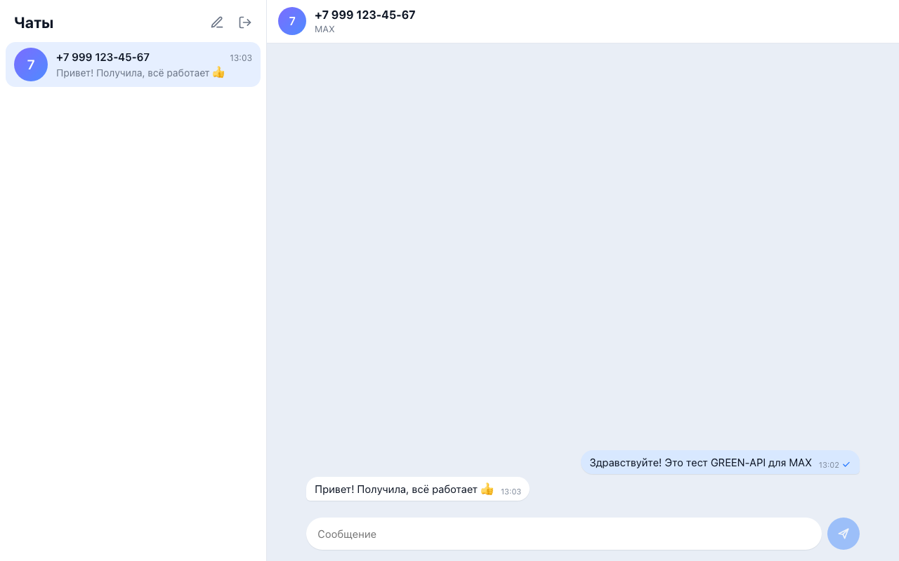
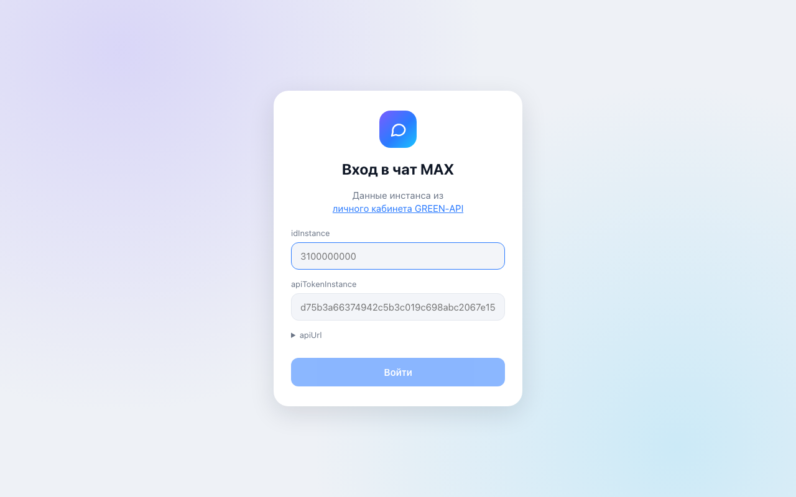
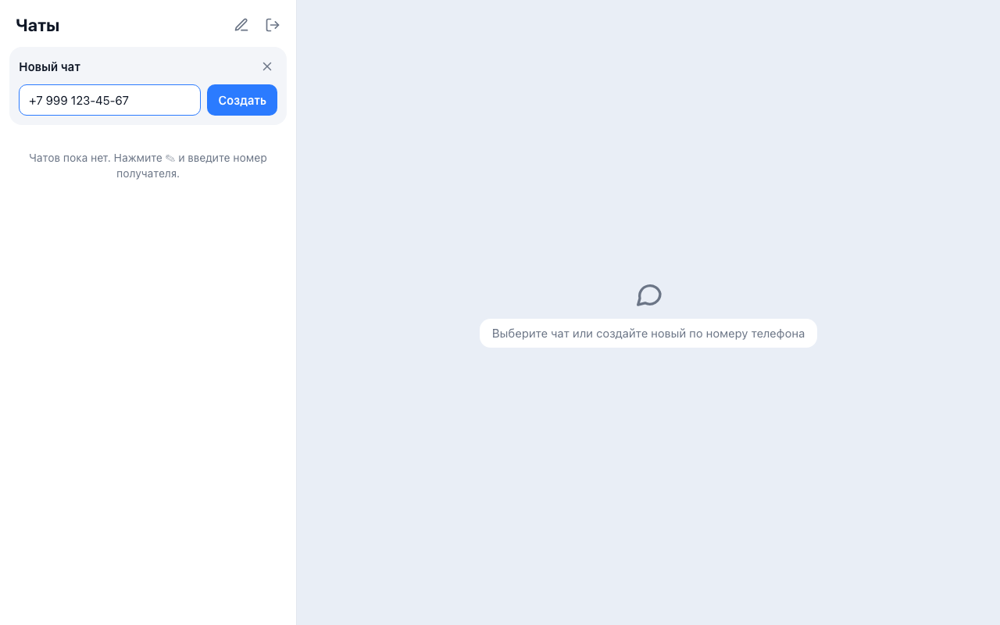
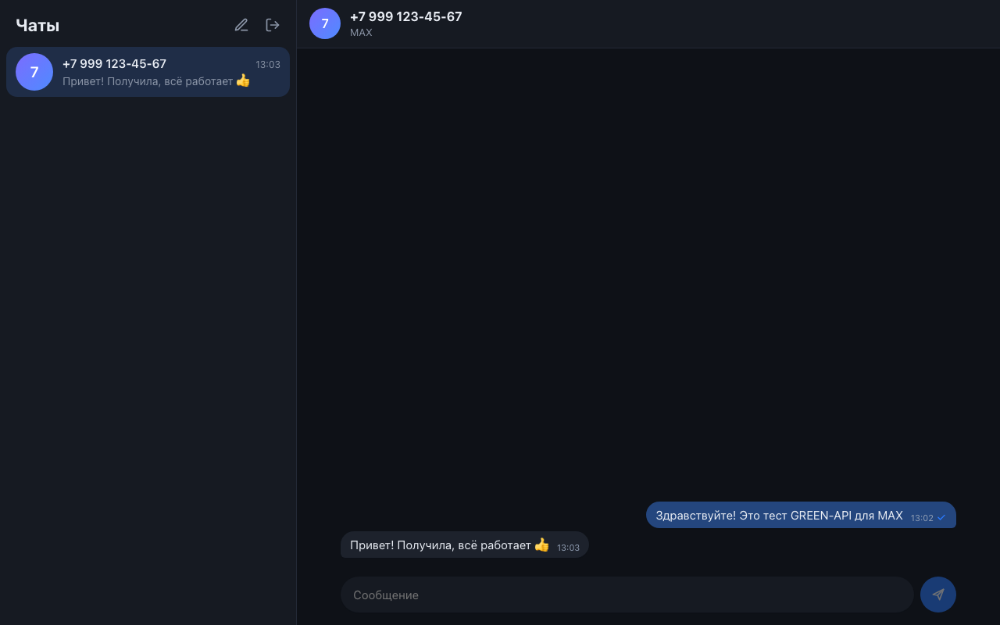
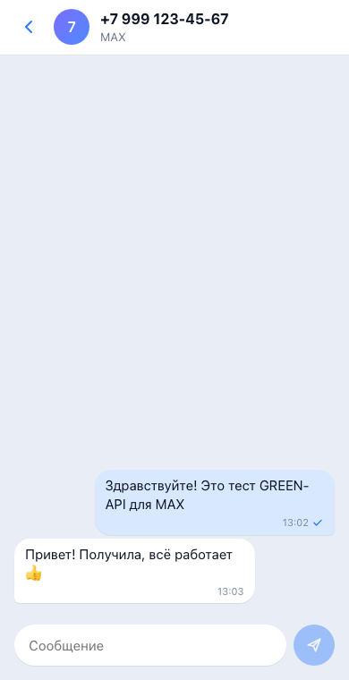

# MAX-чат на GREEN-API

Тестовое задание «Фронтенд-разработчик React»: веб-интерфейс для отправки и получения текстовых сообщений в мессенджере MAX через [GREEN-API](https://green-api.com/max). Внешний вид повторяет [web.max.ru](https://web.max.ru/).



## Что умеет

1. Вход по `idInstance` и `apiTokenInstance` из [личного кабинета GREEN-API](https://console.green-api.com/). Данные проверяются запросом `getStateInstance`, инстанс должен быть авторизован в MAX.
2. Новый чат по номеру телефона получателя.
3. Отправка текстового сообщения методом [`SendMessage`](https://green-api.com/v3/docs/api/sending/SendMessage/).
4. Получение ответов по [HTTP API](https://green-api.com/v3/docs/api/receiving/technology-http-api/): `ReceiveNotification` → обработка → `DeleteNotification`.

Чаты и учётные данные хранятся в `localStorage`, перезагрузка страницы их не теряет. Кнопка выхода очищает всё.

## Запуск локально

Нужен Node.js 20+.

```bash
git clone https://github.com/WhoStoleMySleep/tz-green-api.git
cd tz-green-api
npm install
npm run dev
```

Откройте http://localhost:5173 и введите `idInstance` и `apiTokenInstance`. Поле `apiUrl` по умолчанию `https://api.green-api.com/v3`. Если в личном кабинете у инстанса указан другой `apiUrl`, его можно поменять в форме входа.

### Настройка инстанса

Чтобы ответы приходили в чат, в настройках инстанса в личном кабинете:

- поле **URL для отправки уведомлений (webhookUrl) должно быть пустым**: пока оно задано, уведомления уходят на вебхук, а не в очередь HTTP API;
- включено получение уведомлений о входящих сообщениях (`incomingWebhook`).

### Команды

| Команда                 | Что делает                                              |
| ----------------------- | ------------------------------------------------------- |
| `npm run dev`           | dev-сервер Vite                                         |
| `npm run build`         | проверка типов и production-сборка в `dist/`            |
| `npm run preview`       | локальный просмотр сборки                               |
| `npm test`              | тесты Vitest                                            |
| `npm run test:coverage` | тесты с отчётом покрытия                                |
| `npm run typecheck`     | проверка типов приложения и тестов                      |
| `npm run lint:all`      | ESLint и Stylelint                                      |
| `npm run format`        | Prettier по всему проекту                               |
| `npm run check`         | типы, линтеры, форматирование и тесты — то же, что в CI |
| `npm run check:fix`     | автоисправление линтеров и форматирования, затем тесты  |
| `npm run cz`            | коммит по шаблону `type(scope): subject`                |

Git-хуки (husky): перед коммитом lint-staged прогоняет ESLint, Prettier, Stylelint и связанные тесты по изменённым файлам, перед push запускаются все тесты.

## Как устроено

```
src/
  api/greenApi.ts              клиент GREEN-API: ошибки возвращаются значением { ok, error }
  services/notificationPoller.ts  цикл receiveNotification → обработка → deleteNotification
  stores/                      zustand: учётные данные и чаты (persist в localStorage)
  hooks/                       вход/выход, создание чата, отправка, подписка на уведомления
  utils/                       телефон, разбор уведомлений, дата, аватары
  components/                  экран входа, список чатов, окно переписки
tests/                         зеркально src/
```

Решения, которые неочевидны из кода:

- **Номер → chatId.** В MAX у GREEN-API `chatId` — это ID пользователя MAX, а не номер телефона. Ответ собеседника приходит с этим ID, поэтому при создании чата номер сначала проверяется методом `CheckAccount`, и чат сохраняется под полученным `chatId`. Так ответы попадают в тот же чат, а пользователь сразу узнаёт, что номера нет в MAX.
- **Без дублей.** Отправленное сообщение сразу появляется в чате со статусом «отправляется», после ответа `SendMessage` получает `idMessage`. То же сообщение затем приходит уведомлением `outgoingAPIMessageReceived`, и по `idMessage` дубль отсеивается, в каком бы порядке ни пришли ответ и уведомление.
- **Один цикл опроса.** Long-poll с `receiveTimeout=20` работает, пока открыт чат, и останавливается через `AbortController` при выходе. После сетевой ошибки цикл ждёт 3 секунды и показывает плашку «нет связи».
- **Сообщения от новых собеседников.** Если пишет человек, с которым чата ещё нет, чат создаётся автоматически с его именем из уведомления.
- Принимаются только текстовые сообщения (`textMessage`, `extendedTextMessage`), как требует задание. Остальные уведомления удаляются из очереди, чтобы не мешать.

## Стек

React 19, TypeScript, Vite, Zustand, CSS Modules. Тесты: Vitest, Testing Library, happy-dom. Есть тест полного сценария из задания: вход → новый чат по номеру → отправка → ответ получателя виден в чате.

## Деплой

`.github/workflows/deploy.yml` на каждый пуш в `main` прогоняет тесты, собирает проект и публикует его на GitHub Pages. В настройках репозитория нужно выбрать **Settings → Pages → Source: GitHub Actions**.

## Скриншоты

| Вход                            | Новый чат                         | Тёмная тема                         | Мобильная версия                      |
| ------------------------------- | --------------------------------- | ----------------------------------- | ------------------------------------- |
|  |  |  |  |
